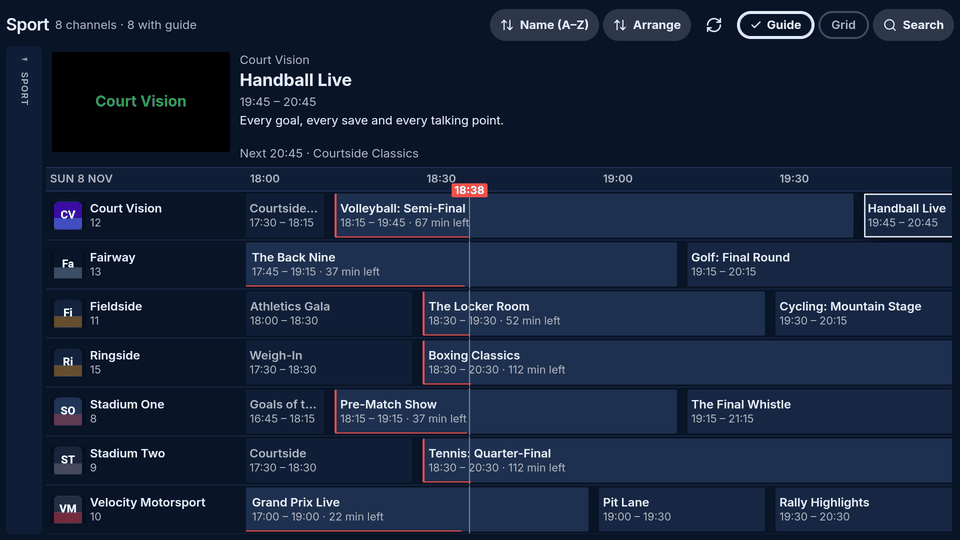
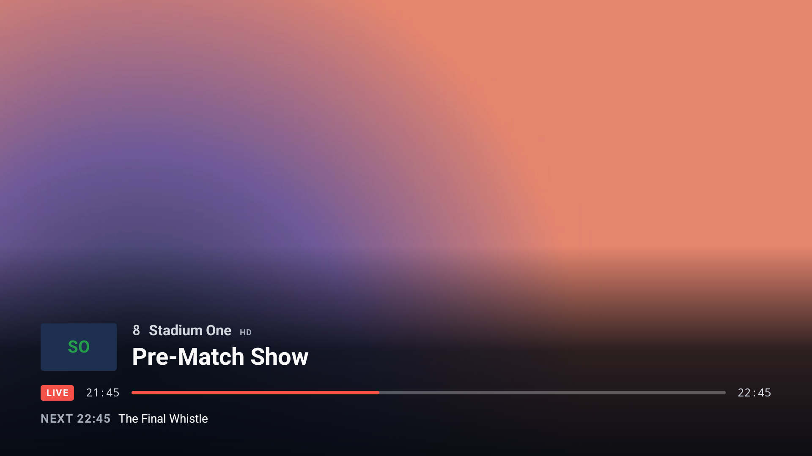
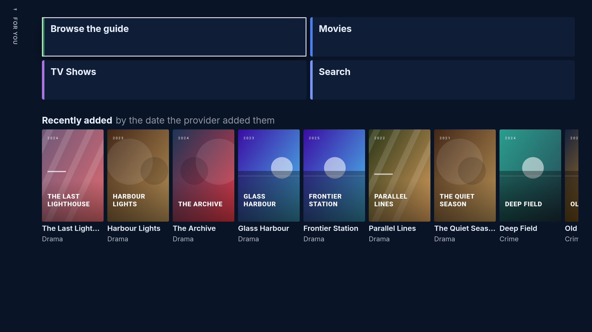
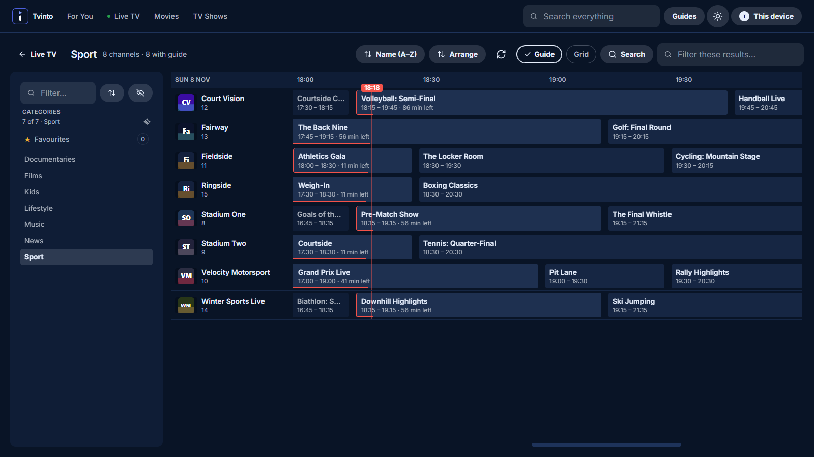
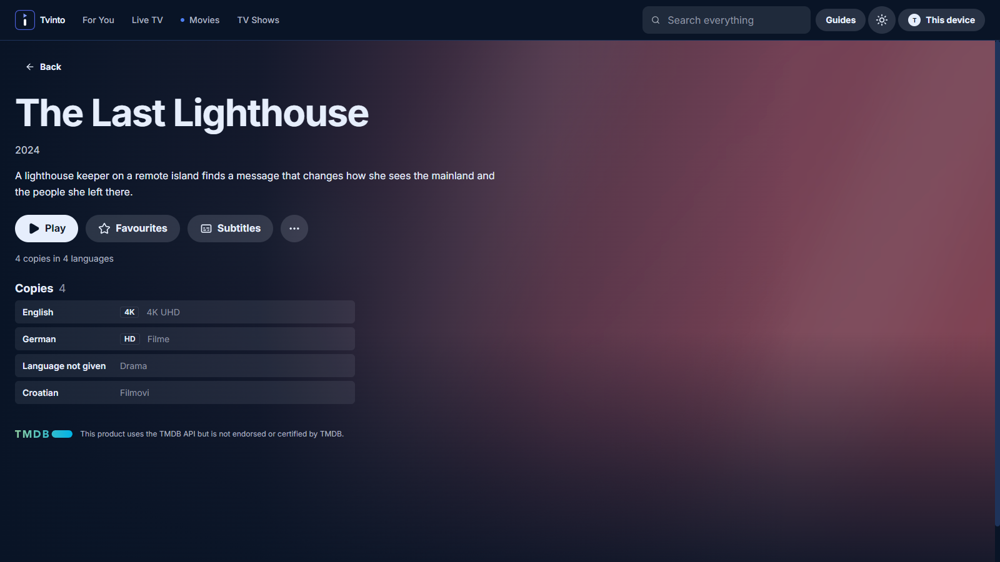
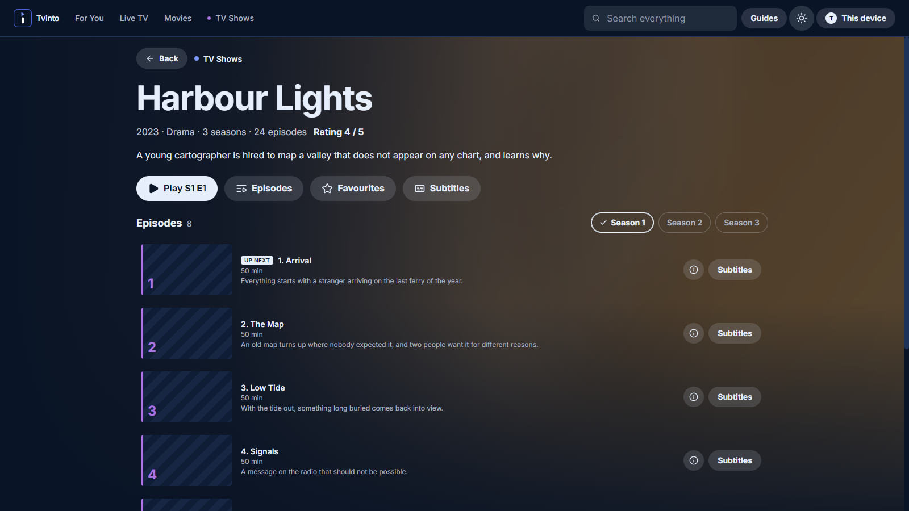
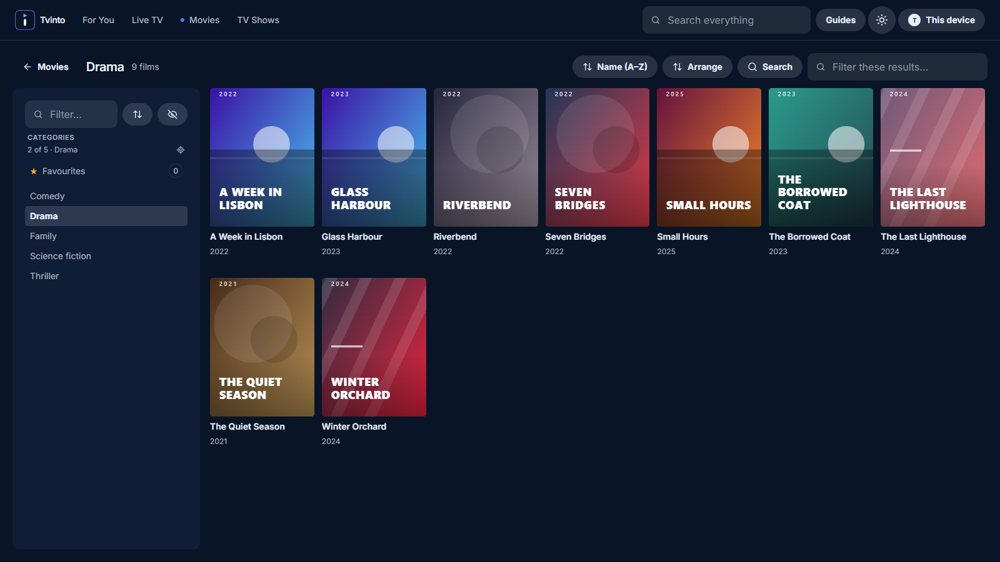
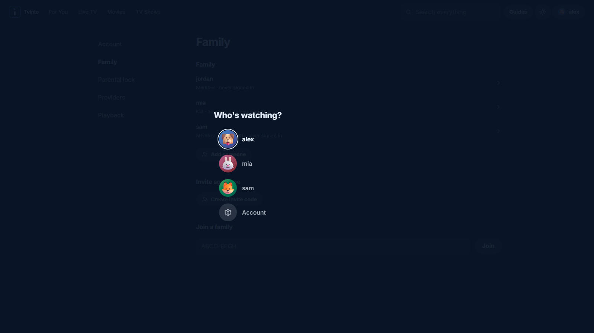
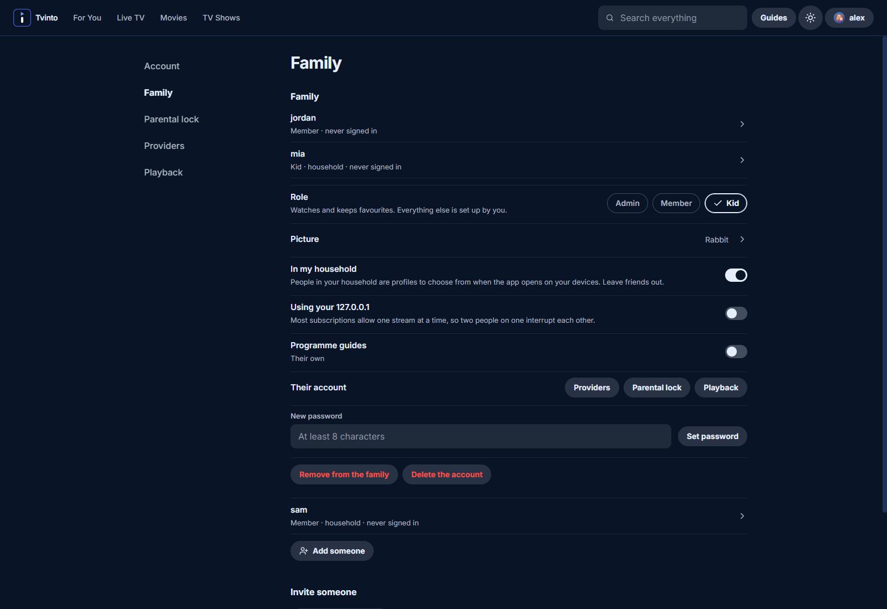

<p align="center">
  
</p>

<p align="center">
  An open source IPTV player for your TV, phone and computer.<br>
  Your devices stay in sync through a server you can run yourself.
</p>

---

Tvinto plays the IPTV subscription you already have (Xtream codes or an M3U
playlist) on **Android TV**, **Android phones** and **Windows**. You get a
programme guide, catch-up, films and series, and a player that is easy to use
with a remote.

You don't need an account. Tvinto works fine on a single device. If you want
your devices to share favourites, history, guides and settings, you can set up
your own **sync service on a free Cloudflare account** with one button. Your
provider login and your guides are encrypted on your devices before they are
sent, and only your devices hold the key.

> **Tvinto is only a player.** It doesn't come with any channels, playlists or
> subscriptions, and it doesn't recommend any. You need your own subscription
> from a provider that is allowed to sell it to you.

<p align="center">
  
</p>

| | |
| --- | --- |
|  |  |
|  |  |
|  |  |
|  |  |

<sub>All channels, programmes, films and shows in these pictures are made up. They come from the
test provider in `tools/qa/fake-xtream.js --demo`.</sub>

## Features

- **Live TV with a proper guide.** A TV-style grid, a mini guide inside the
  player, channel numbers, last channel, catch-up (if your provider has it)
  and programme reminders. The guide can come from your provider or from any
  XMLTV source. If a channel is matched to the wrong guide, you can fix it by
  hand, and the fix syncs to your other devices.
- **Films and series.** Providers often list the same film many times, once
  per language and quality ("EN| Dune 4K", "HR| Dune", "DE| Dune HD").
  Tvinto shows it as one film, with every copy side by side, and plays the
  one in your language first. Pages get backdrops and descriptions from TMDB
  in your language, plus what's popular this week and Continue watching.
- **A player made for the sofa.** Audio and subtitle tracks, subtitles from
  OpenSubtitles, subtitle timing, next episode, a sleep timer, frame rate
  matching on TVs, and changing channels without leaving the player.
- **Your library.** Favourites, history, Continue watching, search across
  everything, and hiding, locking (with a PIN) and arranging categories and
  channels. Use several providers and M3U playlists at once.
- **Made for the TV.** It can open straight into your last channel when the
  TV turns on, play a preview of the channel you rest on in the guide, and
  show your favourite channels and what you watched lately on the Android TV
  home screen.
- **Family and friends.** See [below](#family-and-friends).
- **A command line and an AI tool.** The `tvinto` command can change your
  account the same way the app does (providers, guides, channel matches,
  sorting, hidden categories, the family). It also works as an MCP server, so
  an AI agent can make those changes for you. Every change is shown to you
  first and can be undone, and no passwords or keys ever go through it.

## What's free, and what needs a key

Tvinto costs nothing. Most of it works as soon as you add your provider.

| | What you get |
| --- | --- |
| **Straight away**, no account, no keys | Live TV, the guide and catch-up, guides from your provider or any XMLTV address, films and series with your provider's posters and descriptions, every copy of a film grouped together, the player, favourites, history, search, hiding, locking and arranging, several providers, and the TV extras |
| **With a sync service** (your own, free on Cloudflare) | Sync between your devices, family and friends, invites, subtitles saved for every device, and the command line working on your account |
| **With a free TMDB key** | Descriptions in your language, genres, Popular this week, More like this, scores, trailers, locking films and shows by age rating, and grouping copies that are listed under a translated title |
| **With a free OpenSubtitles key** | Adding subtitles to films and episodes |

**Who adds the keys.** Whoever runs the sync service adds the TMDB key and
the OpenSubtitles API key once, and everyone on that service gets them (see
[server/README.md](server/README.md)). Without an account, you can enter your
own TMDB key in the app instead. For subtitles, each person also links their
own free OpenSubtitles account, which allows 20 downloads a day. The keys are
free from [themoviedb.org](https://www.themoviedb.org/settings/api) and
[opensubtitles.com](https://www.opensubtitles.com/consumers).

## Family and friends

With a sync service, everyone gets their own account, with their own
favourites, history and settings. You can set up their subscription, guides
and settings for them, so nobody has to type a server address on a remote.
Nothing reaches their account until you press Save & Close.

- **Invites.** Make a one-time code in the app (Account, Invite someone). It's
  valid for a week, and they type it in when creating their account.
- **Household.** People who live with you appear under *Who's watching?* when
  the app opens on your devices. Friends are left out of it and use their own
  devices.
- **Roles.** *Admins* can add and set up people. *Members* manage their own
  account. *Kids* can watch and keep favourites, and everything else is set up
  for them.
- **Kids.** Lock categories behind a PIN, and lock films and shows by age
  rating for your country.
- **Pictures.** Pick an animal or upload a photo for each profile.
- **Leaving.** Anyone can leave a family and keep their account, favourites
  and history.



## Download

Get it from the [Releases page](https://github.com/tvinto/tvinto/releases):
the APK for Android TV and phones, and the installer for Windows. Both update
themselves.

1. Install it and open it. It starts with **Add your provider**. No account
   needed.
2. To sync between devices, set up your own sync service (see below), or sign
   in to one that someone else runs for you.

## Your own sync service

The [`server/`](server/README.md) folder is the sync service, ready for
Cloudflare's free plan. Press **Deploy to Cloudflare** in its README, or run
`tvinto server init`. A whole household fits easily in the free plan.

Everything is encrypted on your devices first. The service keeps your
favourites and history, plus encrypted copies of your provider logins and
guides that it can't read. [docs/architecture.md](docs/architecture.md)
explains how.

## What Tvinto sends

When something goes wrong, the apps you download from this project send an
error report: what failed, the app version, and the kind of device and
system. Never your provider, its address, username or password, your
channels, what you watch, your account or your IP address. Only errors:
nothing about how you use the app.

It's on from the start, and the first screen says so. Turn it off in the app
under Account, Playback, "Send error reports", or with
`tvinto error-reports off`. Off means nothing is sent. If you build Tvinto
yourself, it sends nothing at all. [docs/error-reports.md](docs/error-reports.md)
has the details.

## Command line and AI agents

`tvinto` is a command line tool for changing your setup without opening the
app: hide categories, sort channels, match channels to a guide, change player
settings and more. It can also run as an MCP server, so an AI agent like
Claude can do these things for you.

```bash
npx tvinto sign-in --server https://tvinto-sync.yourname.workers.dev
npx tvinto hide live 12 15      # shows what will change, and a code
npx tvinto apply K7P2           # nothing changes until you apply it
claude mcp add tvinto -- npx -y tvinto mcp
```

That needs Node.js 20 or newer, and nothing else. Without Node, the desktop
app carries tvinto and runs it itself: Account, Tools shows the commands for
your computer, ready to copy.

Every change is shown to you first and can be undone, and an agent can't
apply anything without your confirmation. [cli/README.md](cli/README.md)
explains everything it can do.

## Building it

```bash
npm install                      # the root folder, which shared/ uses
cd frontend && npm install && npm run build
```

For Android you need the Android SDK (it comes with Android Studio). Windows
needs nothing else. Tests, each platform, and the things worth knowing before
you start are all in [docs/building.md](docs/building.md).

## The code

| Folder | What's in it |
| --- | --- |
| `frontend/` | The app. Angular, turned into an Android app with Capacitor (native players in `android/`) and a Windows app with Electron (`electron/`, playing through mpv) |
| `shared/` | Code that every part uses: Xtream and M3U, guides, sync, encryption, the family |
| `worker/` | The sync service, a Cloudflare Worker with a D1 database |
| `server/` | The same service packed for the Deploy button. Generated from `worker/` |
| `cli/` | `tvinto`, the command line and MCP server |
| `backend/` | The original Express server. Now it mostly runs the tests for `shared/`, `worker/` and `cli/` |
| `brand/` | The logo, generated by `tools/brand/` |

## Contributing

Issues and pull requests are welcome. See [CONTRIBUTING.md](CONTRIBUTING.md).
Please report security problems privately, as described in
[SECURITY.md](SECURITY.md).

## Licence and name

The apps are under the [GNU GPL v3](LICENSE). The sync service (`worker/` and
`server/`) is under the [GNU AGPL v3](worker/LICENSE), so anyone hosting a
changed copy has to share their changes too. The profile pictures are
Microsoft's Fluent Emoji (MIT).

The name **Tvinto** and its logo are not covered by these licences. If you
change the app and share it, give it your own name and icon. See
[NAME-POLICY.md](NAME-POLICY.md).
